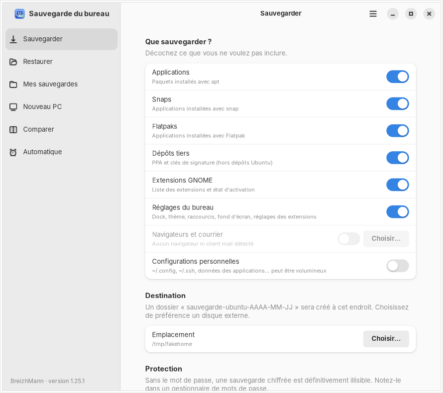
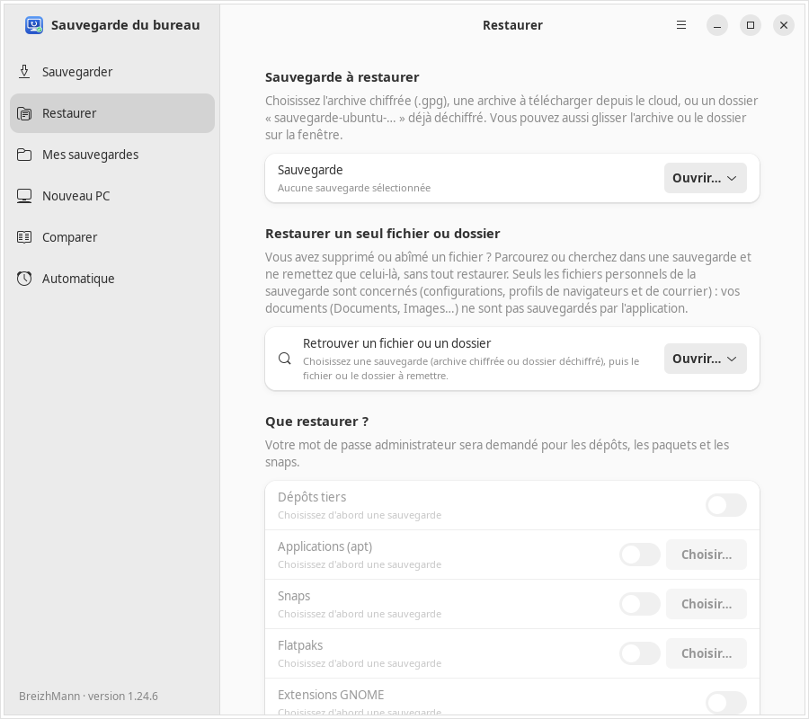
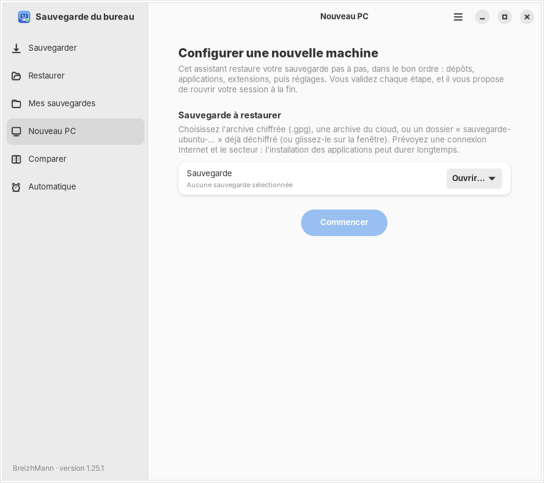
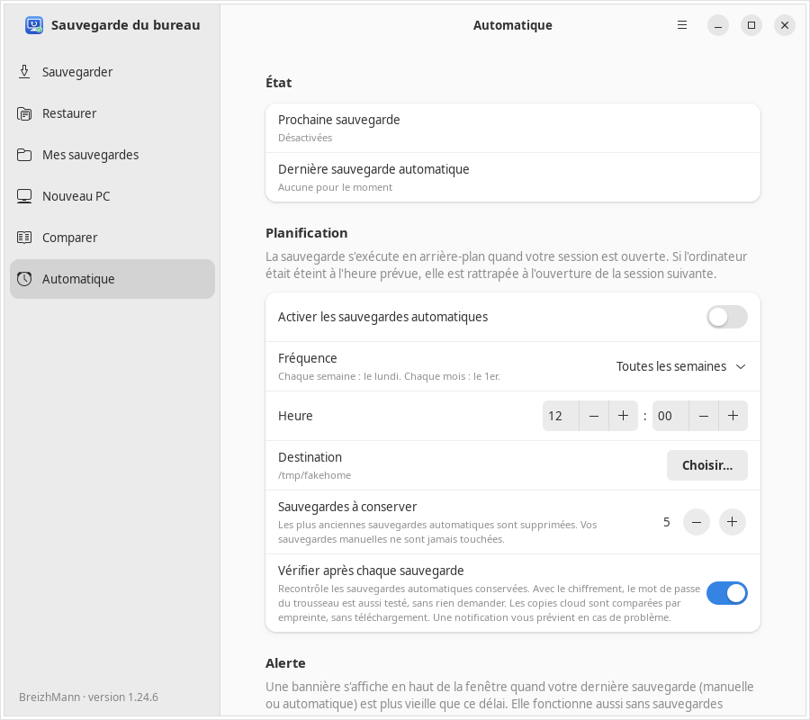

# Sauvegarde du bureau

🇫🇷 Français · [🇬🇧 English](README.en.md)

Application GNOME (GTK4 / libadwaita) pour **sauvegarder et restaurer son bureau Ubuntu** : applications, dépôts tiers, extensions GNOME et réglages.



## Ce qu'elle sauvegarde

- Applications installées avec **apt**, **snap** et **flatpak**
- Dépôts tiers (PPA) et leurs clés de signature
- Extensions GNOME et leur état d'activation
- Réglages du bureau (dconf) : dock, thème, raccourcis, fond d'écran…
- Profils de navigateurs et de courrier, configurations personnelles (facultatif)

## Fonctions

- Sauvegardes protégées par une somme de contrôle **SHA-256**, vérifiée à la création et avant restauration
- Chiffrement des archives (GPG) et envoi dans le cloud avec **rclone**
- Restauration complète, ou d'un seul fichier ou dossier
- Assistant **« Nouveau PC »** pour tout remettre en place, étape par étape
- Comparaison de deux sauvegardes
- Sauvegardes **automatiques** planifiées, avec rotation et alerte si la dernière est trop ancienne
- Interface en **français et en anglais**, selon la langue du système

| Restaurer | Nouveau PC | Automatique |
|---|---|---|
|  |  |  |

## Installation

Téléchargez le fichier `.deb` dans la page [Releases](../../releases), puis :

```bash
sudo apt install ./sauvegarde-bureau_*_all.deb
```

Prérequis : Ubuntu avec GNOME et libadwaita 1.5 ou plus (Ubuntu 24.04 et suivants).

## Construire le paquet soi-même

```bash
git clone https://github.com/BreizhMann/sauvegarde-bureau.git
cd sauvegarde-bureau
make deb
```

Le paquet est créé dans `dist/`. La construction a besoin du paquet `gettext` (`sudo apt install gettext`), qui compile les traductions.

## Traduire

Les textes sont dans `po/`. Pour ajouter une langue : copier `po/sauvegarde-bureau.pot` en `po/xx.po` (par exemple `po/de.po`), traduire les textes, puis lancer `make deb`. Pour mettre le modèle à jour après une modification du code : `make pot`. Une langue sans traduction s'affiche en anglais ; le français est la langue d'origine du code.

## Licence

[MIT](LICENSE) © 2026 BreizhMann — <https://www.iactualite.info/>
